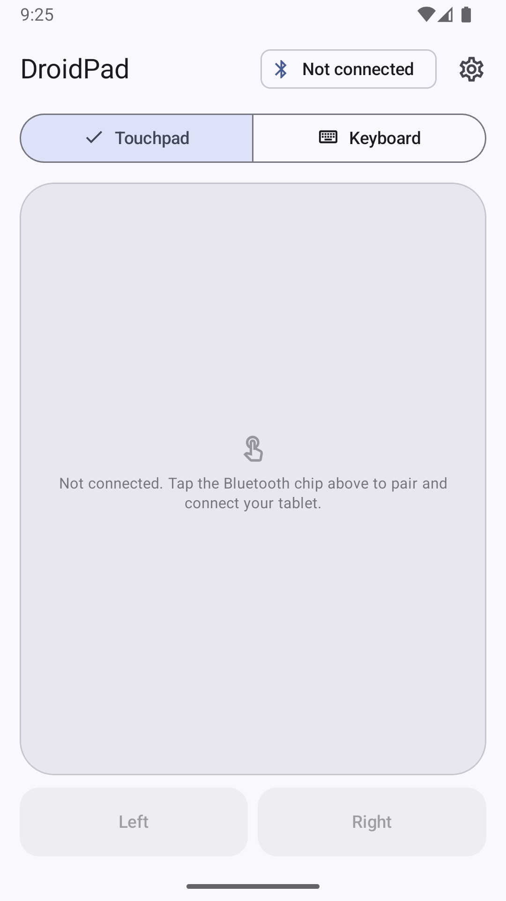
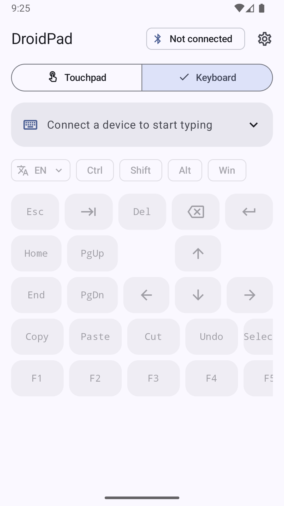
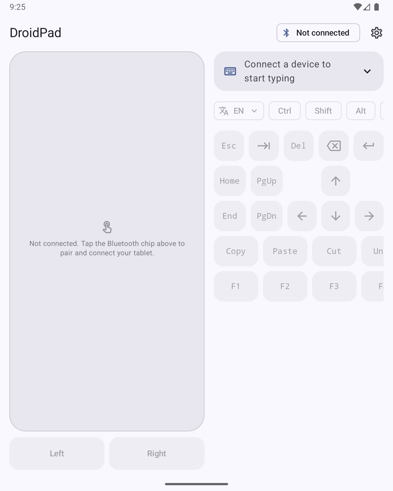
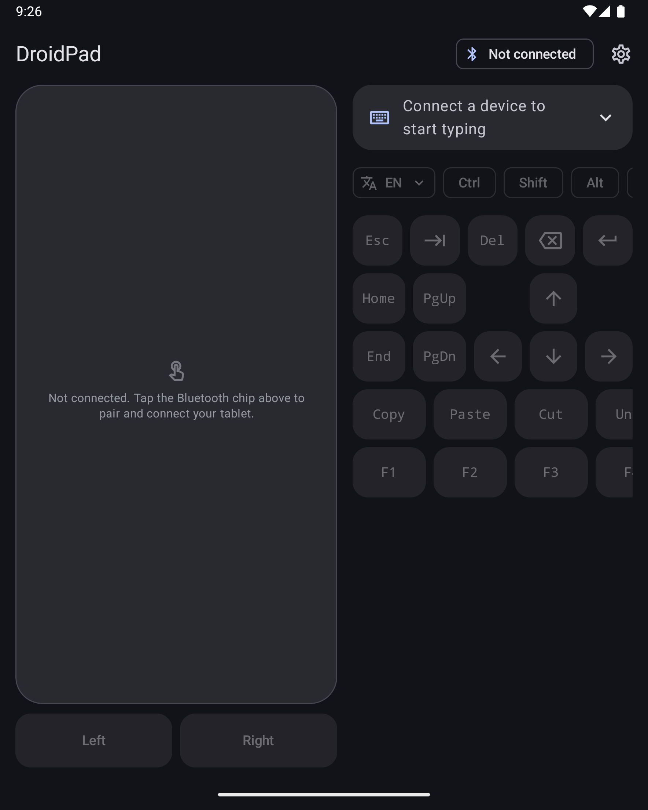

# DroidPad

갤럭시 폴드(또는 Android 12+ 폰)를 **블루투스 키보드 + 터치패드**로 만들어 갤럭시탭 등 다른 기기를 제어하는 Android 앱입니다.

대상 기기(호스트)에는 **아무 앱도 설치할 필요가 없습니다.** Android 공식 `BluetoothHidDevice` API로 표준 Bluetooth Classic HID 키보드·마우스 복합 장치를 에뮬레이션하므로, 탭은 DroidPad를 일반 블루투스 키보드/마우스로 인식합니다. 인터넷, 서버, 루팅이 필요 없습니다.

| 접힘 · 터치패드 | 접힘 · 키보드 | 펼침 (라이트) | 펼침 (다크) |
|---|---|---|---|
|  |  |  |  |

> 스크린샷은 에뮬레이터에서 촬영했습니다(블루투스 미연결 상태).

## 다운로드

[Releases](https://github.com/lafin716/droidpad/releases/latest)에서 `DroidPad-vX.Y.Z.apk`를 받아 설치합니다. ("출처를 알 수 없는 앱 설치" 허용 필요)

- 요구 사항: **Android 12 (API 31) 이상**, 기기 제조사가 Bluetooth HID Device 프로파일을 활성화한 기기 (최근 삼성 갤럭시 기기는 대부분 지원)
- 앱의 *기기 › 진단* 항목에서 HID Device 프로파일 지원 여부를 확인할 수 있습니다.

## 기능

### 블루투스
- HID 키보드(Report ID 1) + 마우스(Report ID 2, 휠·수평 스크롤 포함) 복합 장치
- 페어링 안내, "2분간 검색 허용"(남은 시간 표시), 주변 기기 검색, 페어링된 기기 연결/해제
- 마지막 연결 기기 자동 재연결(지수 백오프), 연결 상태·오류 표시
- HID 프로파일 미지원 기기 감지 및 안내

### 터치패드
| 제스처 | 동작 |
|---|---|
| 한 손가락 이동 | 포인터 이동 (가속 옵션) |
| 탭 | 좌클릭 |
| 두 번 탭 | 더블클릭 |
| 두 손가락 탭 | 우클릭 |
| 세 손가락 탭 | 가운데 클릭 |
| 두 손가락 이동 | 세로/가로 스크롤 (자연 스크롤 옵션) |
| 길게 누른 뒤 이동 | 드래그 (손을 떼면 놓기) |

하단 Left/Right 버튼으로도 클릭할 수 있습니다. 포인터 속도·스크롤 속도·가속·자연 스크롤·탭 클릭·햅틱은 설정에서 조절합니다.

### 키보드
- 폰의 **삼성 키보드 등 기본 IME로 입력**하면 입력 내용이 HID 키 입력으로 변환되어 전송됩니다.
- 영문, 숫자, 특수문자(US 레이아웃), **한글(두벌식 자모 단위 전송)**, 조합 중 수정·백스페이스 지원
- Ctrl / Shift / Alt / Win 고정 수식키, Esc, Tab, Del, Backspace, Enter, Home/End, PgUp/PgDn, 방향키, F1–F12, 복사/붙여넣기/잘라내기/실행취소/전체선택, 앱 전환 단축키
- **자동 한/영 전환**: 영문과 한글이 바뀔 때 탭의 언어 전환 키를 자동으로 보냅니다. 전환 키는 설정에서 선택(Shift+Space, 한/영 키, 오른쪽 Alt, Ctrl+Space).
- **입력 방식 선택**: 설정 › 키보드에서 시스템 키보드(IME) 또는 **전체 화면 키보드**를 고릅니다. 전체 화면 키보드는 F키 줄이 있는 QWERTY 배열로 실제 키 입력을 바로 보내며, 탭이 한글 상태면 두벌식 자모를 표시합니다.

### 레이아웃
- **좌우 바꾸기**: 펼친 화면에서 터치패드와 키 영역의 위치를 바꿉니다.
- **커스텀 레이아웃**: 설정 › 레이아웃 › *레이아웃 편집*에서 키 한 칸 단위의 격자에 터치패드, 마우스 버튼, 수식키, 방향키, F1–F12, 단축키, 입력창을 배치합니다. 빈 칸을 탭해 추가하고, 끌어서 이동하고, 모서리 핸들로 크기를 조절합니다. 레이아웃은 격자 크기(화면 상태)마다 따로 저장됩니다.

## 사용법

1. 폴드에서 DroidPad 실행 → 블루투스 권한 허용.
2. 상단 **블루투스 칩** → *2분간 검색 허용*.
3. 탭에서 **설정 › 연결 › 블루투스**를 열고 폴드를 선택 → 양쪽에서 페어링 수락.
   (또는 DroidPad의 *주변 기기 검색*에서 탭을 골라 연결)
4. 연결되면 **터치패드 / 키보드** 탭을 전환하며 사용합니다. 폴드를 펼치면 터치패드와 키보드가 나란히 표시됩니다.

### 한글 입력 팁
- 탭은 HID 입력을 "물리 키보드"로 처리합니다. 탭의 **설정 › 일반 › 물리 키보드**(또는 삼성 키보드 설정)에서 언어 전환 키를 확인하고, DroidPad *설정 › 키보드 › 탭 언어 전환 키*를 같은 값으로 맞추세요. 삼성 기기의 기본값은 대개 **Shift+Space**입니다.
- HID에는 호스트의 현재 입력 언어를 읽어오는 방법이 없습니다. 탭의 실제 언어와 DroidPad가 추정한 언어가 어긋나면, 키보드 화면의 **EN/한 메뉴**에서 현재 언어를 맞춰 주세요(동기화).
- DroidPad는 자모를 두벌식 키(ㄱ=r, ㅏ=k …)로 보내므로 탭의 한국어 물리 키보드 레이아웃이 **두벌식**이어야 합니다.

## 알려진 제약

- **실제 기기 미검증**: 개발 환경의 에뮬레이터는 Bluetooth HID를 지원하지 않아, 블루투스 연결·키 입력·터치패드 전송은 실제 폴드/탭 조합에서 아직 검증되지 않았습니다. 단위 테스트(HID 리포트, 한글 분해, 제스처 상태 머신 등)와 에뮬레이터 UI 스모크 테스트만 통과했습니다.
- 호스트의 입력 언어 상태는 HID로 알 수 없어 추정합니다(수동 동기화 제공).
- IME 자동 수정·예측 변환 결과는 "지우고 다시 입력" 방식으로 반영되어 순간적으로 여러 키가 전송될 수 있습니다.
- Caps Lock 보정은 영문에만 적용됩니다. 이모지 등 HID 키로 표현할 수 없는 문자는 건너뜁니다.
- 전경 서비스를 쓰지 않으므로 앱이 백그라운드로 가면 일정 시간 후 연결이 끊길 수 있습니다.
- 키보드 미러링은 호스트 커서가 입력 끝에 있다고 가정합니다. 탭에서 커서를 옮겼다면 입력창을 지우고(초기화) 다시 입력하세요.
- 일부 제조사 기기는 HID Device 프로파일이 비활성화되어 있어 사용할 수 없습니다.

## 빌드

```bash
# JDK 17+ / Android SDK 36 필요
./gradlew lintDebug testDebugUnitTest assembleDebug
```

### 서명된 릴리즈
서명 키는 저장소에 포함되지 않습니다. 다음 환경 변수 또는 저장소 루트의 `keystore.properties`(git 무시됨)로 주입합니다.

| 환경 변수 | keystore.properties |
|---|---|
| `DROIDPAD_KEYSTORE_PATH` | `storeFile` |
| `DROIDPAD_KEYSTORE_PASSWORD` | `storePassword` |
| `DROIDPAD_KEY_ALIAS` | `keyAlias` |
| `DROIDPAD_KEY_PASSWORD` | `keyPassword` |

```bash
./gradlew assembleRelease
```

### CI / 릴리즈
- `.github/workflows/ci.yml`: push/PR마다 lint, 단위 테스트, 디버그 APK 빌드.
- `.github/workflows/release.yml`: `v*` 태그 push 시 GitHub Secrets(`DROIDPAD_KEYSTORE_BASE64`, `DROIDPAD_KEYSTORE_PASSWORD`, `DROIDPAD_KEY_ALIAS`, `DROIDPAD_KEY_PASSWORD`)로 서명된 APK를 빌드·검증(apksigner)하고 GitHub Release에 업로드합니다.

## 구조

```
app/src/main/java/com/droidpad/app/
├── hid/            HID 디스크립터, 리포트 인코딩, 전송 큐, 연결 관리, 재연결 정책
├── input/
│   ├── keyboard/   ASCII→HID, 한글 자모 분해, IME 텍스트 미러링, 한/영 전환
│   └── touchpad/   제스처 상태 머신, 포인터 가속
├── data/           DataStore 설정
└── ui/             Compose 화면(제어, 기기, 설정)과 컴포넌트
```

## 라이선스

[MIT](LICENSE)
